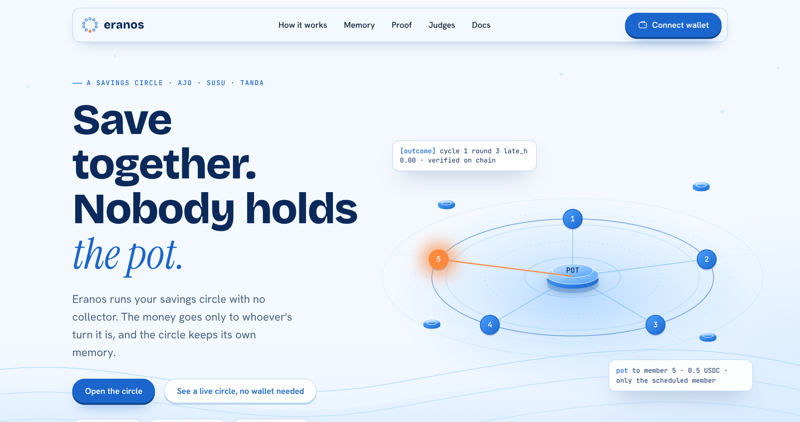
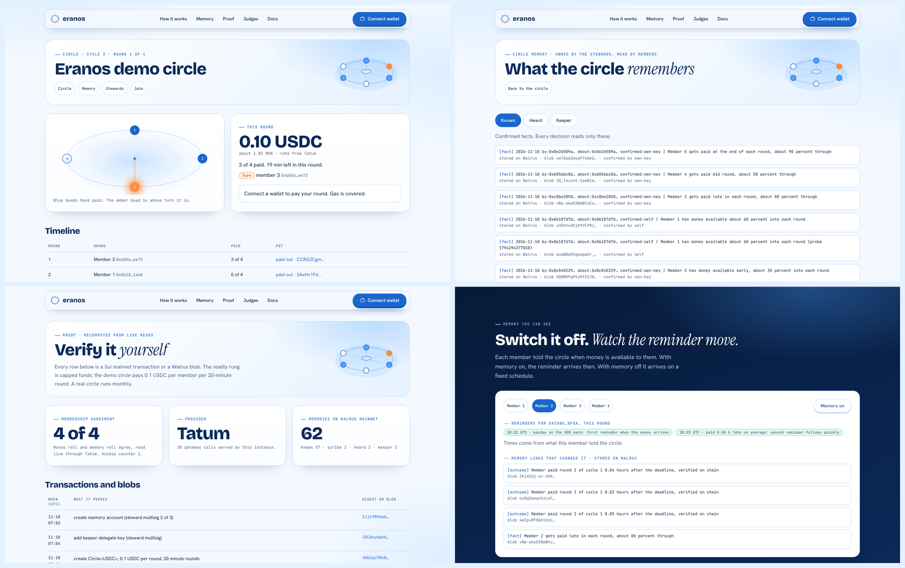
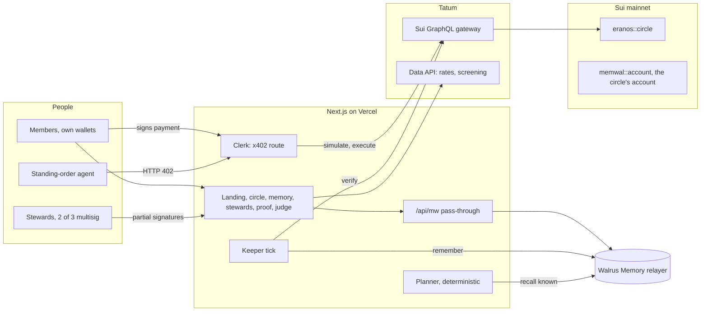
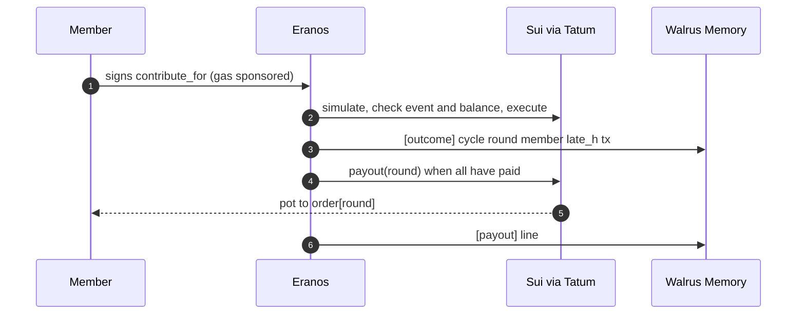
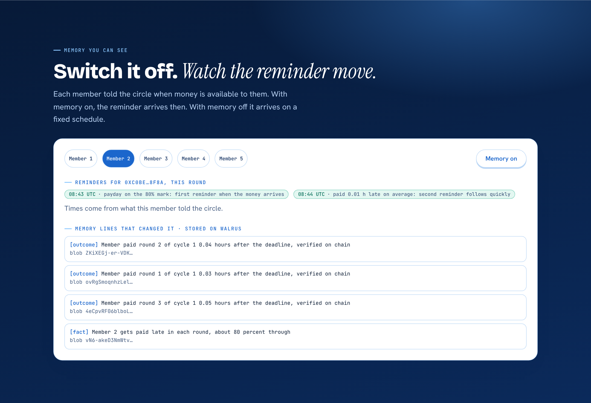
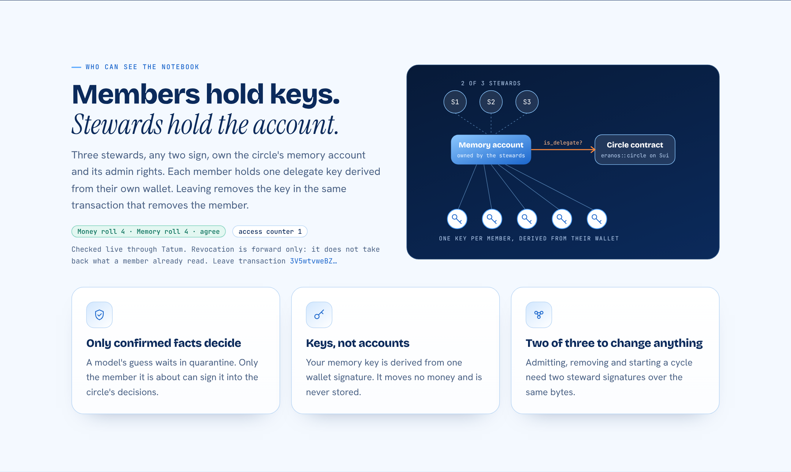
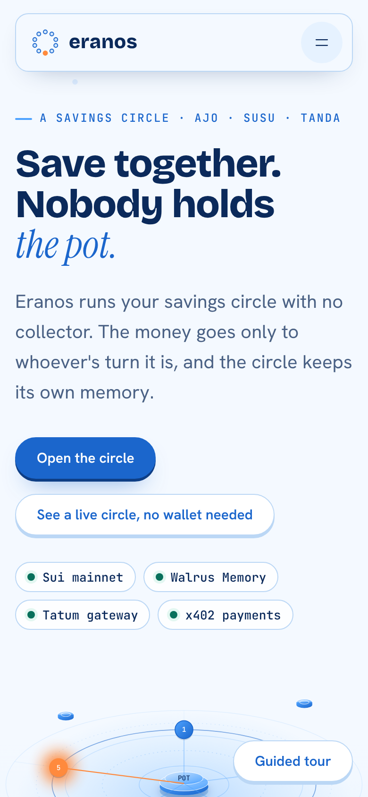

<p align="center"></p>

<h1 align="center">Eranos</h1>

<p align="center"><strong>A savings circle with no collector.<br>The money goes only to whoever's turn it is, and the circle owns its own memory.</strong></p>

<p align="center">
<a href="https://eranos.vercel.app">Live app</a> ·
<a href="https://eranos.vercel.app/judge">60-second judge walk</a> ·
<a href="https://eranos.vercel.app/proof">Live proof</a> ·
<a href="https://youtu.be/LDSFkGjC_as">Demo video</a> ·
<a href="docs/BLOG.md">Blog post</a> ·
<a href="docs/EVIDENCE.md">Every transaction</a>
</p>

<p align="center">
<a href="https://eranos.vercel.app"></a>

<a href="https://github.com/0xkinno/eranos/actions/workflows/ci.yml"></a>

</p>



Lucía Herrera (a fictional home-care worker in Houston) paid $200 a month into a ten-person tanda for seven months. July was her turn. The woman holding the money stopped answering her phone, and the notebook that said whose turn it was went with her.

**Eranos is the same circle with nobody in the middle.** Each member pays from their own wallet. A Sui contract pays the pot only to the member whose turn it is. The circle's memory, who paid when and who agreed to what, is kept by the circle itself on Walrus Memory, and it quietly changes how the circle works: reminders arrive when you actually get paid, and the next cycle's order reflects who really pays late.

It is live, on Sui mainnet, with real payments you can verify in under a minute.

| | |
|---|---|
| **Live app** | [eranos.vercel.app](https://eranos.vercel.app) |
| **Judges, no wallet needed** | [/judge](https://eranos.vercel.app/judge) (60 seconds) and the guided tour: [/?tour=1](https://eranos.vercel.app/?tour=1) |
| **Proof, recomputed live** | [/proof](https://eranos.vercel.app/proof) |
| **Demo video** | [2:50 on YouTube](https://youtu.be/LDSFkGjC_as) |
| **Blog post** | [docs/BLOG.md](docs/BLOG.md) |
| **Track** | 03 Consumer Finance Apps. Also entered for Best Walrus Memory and Best Use of Agent Payments |
| **Built with** | Walrus Memory SDK 0.1.14, Tatum Sui gateway and Data API, Sui mainnet package `0xf56a7c35676c7486b2078822f5b3ae58e383ac47b9c189fe77c3df3ea03fe42e` |

## Why this is different

Memory products usually keep the user's memory in an account the app owns, and the user is a tenant. Eranos does the reverse, and enforces it where it cannot be argued with:

1. **The circle owns its memory.** One Walrus Memory account per circle, owned by a 2-of-3 steward multisig. Every member holds their own delegate key, derived from their own wallet signature.
2. **Money and memory move together.** Joining adds the member's key to the memory account and puts them on the contract's roll in one transaction. The contract reads the memory account and refuses to admit a member who has no memory key. It refuses to remove one who still has it. The two rolls cannot drift apart, and `/proof` checks that live.
3. **A model's guess cannot decide anything.** Facts extracted from pasted chat wait in quarantine until the person they are about signs.
4. **The keeper cannot invent a payment.** It writes only what Tatum can show on chain. We tried to make it lie. It refused.
5. **An agent can pay for you, and only for you.** x402 payments where the payment *is* the contract call.



## Where the money goes

Reality rung: **Sui mainnet, capped funds.** The demo circle has 4 members, pays 0.1 USDC per member per round, and runs 20-minute rounds so a judge can watch a full cycle. A real circle runs monthly.

| Step | Transaction |
|---|---|
| Contract published | [J5xNYaPp…](https://suiscan.xyz/mainnet/tx/J5xNYaPpydKt4EDxaonUzq7JrG9E6AYprYiWXnCibyGH) |
| Memory account created by the stewards (2 of 3 signatures) | [2JjtfMth…](https://suiscan.xyz/mainnet/tx/2JjtfMthwAHLCBWBeXPnfJYbti3WVz5wbudb7zZAGY8o) |
| Circle created | [3HbCpu7M…](https://suiscan.xyz/mainnet/tx/3HbCpu7MvRNubFnHMvJMxVskdG75cygJPxbohDpa7wwD) |
| Member 1 joins: memory key and money roll in one transaction | [42Dsi8wX…](https://suiscan.xyz/mainnet/tx/42Dsi8wXBjxUNsQbN4q64BA7Sh7KMXUcZU3zhSeFuoyR) |
| Member 2 joins | [5H8bHaM4…](https://suiscan.xyz/mainnet/tx/5H8bHaM43JmVZu7sWq9ztSfCsbVpwM3QDL4mKfFpBznZ) |
| Cycle 1 starts | [2zwqECsH…](https://suiscan.xyz/mainnet/tx/2zwqECsHgoMsgPyJXGECwgZFdDEXv5crNJDvr2fVQbyP) |
| Contributions with sponsored gas (39) | see [/proof](https://eranos.vercel.app/proof) |
| Agent payments over x402 (2) | [3RLmStgo…](https://suiscan.xyz/mainnet/tx/3RLmStgoG5DbWADSEgNkovDYUoaQykZtTmJpzQ7tEwMW), [6F1rX2Mo…](https://suiscan.xyz/mainnet/tx/6F1rX2MoqosN4rZYnAiw1hNfMXrjUeeLZVd565bGjpjb) |
| Payment from a browser wallet on the deployed site (sponsored gas, x402) | [6pYi47oE…](https://suiscan.xyz/mainnet/tx/6pYi47oEzChMSu7dK8bdcrAAgEFZfgUvPU8KgnjwxpiA) |
| First payout | [CCRGJCgm…](https://suiscan.xyz/mainnet/tx/CCRGJCgmpCAk6RjLiLhNsKaegVTSFU982uitVHSjri93) |
| Leave: key removed with the member | [3V5wtvwe…](https://suiscan.xyz/mainnet/tx/3V5wtvweBZR4rDVjUZgVBwQ3XEMQUiC19BPHZXvDzb2t) |
| Cycle 2 starts: the planner's order, signed by two stewards | [2w7d6NZk…](https://suiscan.xyz/mainnet/tx/2w7d6NZkMbnKZEHHVsaWrgYqQMeuataEow455g13p9Uz) |
| Payout before a round is full | refused at Tatum's pre-execution check, abort code 6 `ERoundNotFull` |
| Admit without a memory key | refused at Tatum's pre-execution check, abort code 12 `EMemoryNotGranted` |

## The problem

Rotating savings circles are one of the oldest money tools. They are called ajo in Lagos, susu in Accra, tanda in Houston and Mexico City, chit in Chennai, pardner in London, hui in Taipei and equb in Addis Ababa. In ancient Athens they were an *eranos*. Almost all of them run on one person's trust, phone and notebook.

| What is true | Source |
|---|---|
| ROSCAs are self-help money pools found on most continents, often a member's main or only savings institution | Ardener and Burman (eds.), *Money Go Rounds*, Berg, 1996 (via the Goldsmiths research record) |
| Typical circle size is 8 to 13 people | Joint savings association paper, University of Klagenfurt (cites Guha and Gupta 2005; Kedir and Ibrahim 2011) |
| In Liberia, Malawi and Sierra Leone about a quarter of borrowers borrowed only from savings clubs like ROSCAs | World Bank, Global Findex 2021 |
| A susu collector in Accra was arraigned over about GH¢156,445 taken from 35 traders (outlets differ by ten cedis) | [Modern Ghana](https://www.modernghana.com/news/1509821/susu-collector-arraigned-for-allegedly-defrauding.html) |
| A Nigerian businesswoman lost ₦10 million in ajo savings, due out in July | [Legit.ng](https://www.legit.ng/people/1723654-nigerian-businesswoman-cries-losing-n10-million-ajo-savings-meant-factory/) |
| A woman saving ₦1,000 a day for six months to rent a shop lost it when the ajo collector vanished | [Legit.ng](https://www.legit.ng/people/1718360-lady-shares-experience-saving-money-ajo-collector-what-happened-6-months/) |
| Tandas are used by Mexican American families and by relatives in the South Bronx | [Journal of Family and Economic Issues, tanda paper](https://link.springer.com/content/pdf/10.1007/s10834-023-09913-z.pdf), [South Bronx paper](https://link.springer.com/article/10.1007/s10834-023-09912-0) |
| The default problem in rotating credit | Besley, Coate and Loury, *American Economic Review* 83(4), 1993 |

The organiser as the single point of failure is the Accra case above: the collector held both the money and the records. We searched for a UK pardner case and did not find one, so none is cited.

## What Eranos does

1. **Members join money and memory together.** Three stewards (any two sign) admit a member. One transaction adds the member's key to the circle's Walrus Memory account and puts them on the contract's roll.
2. **Members pay from their own wallet.** The app asks for one signature on a `contribute_for` call. The circle covers gas up to a cap. An agent can pay the same way over x402.
3. **The contract pays only the scheduled member**, and only when everyone has paid.
4. **The keeper verifies and remembers.** It checks each payment on chain through Tatum and writes a typed memory line. It never moves money except by calling the permissionless payout.
5. **The memory changes the plan.** Each member tells the circle when money is available to them. Reminder times and the next cycle's order are computed from those lines, with the lines cited.

The person is the signature and the teacher: they sign their own payment, they teach the circle facts about themselves, and nothing a model guessed can change a decision until the person it is about signs. Always delivered, even when reminders are limited: "your turn landed" and "a steward vote needs you". Reminder budget: two per member per round, none between 21:00 and 08:00 local.

## Explore it in 2 minutes

No wallet: open [/judge](https://eranos.vercel.app/judge), read the ring and round table on the circle page, flip the Memory switch on the landing page, read [/proof](https://eranos.vercel.app/proof).
With a wallet (Slush or Suiet, Ed25519 account): connect, open the circle, join page to create your memory key. Only members can pay.

## Architecture



A single round: members pay, the keeper verifies each payment by digest, writes `[outcome]` lines, and once all have paid calls `payout`, which sends the pot to `order[round]`.



## How Walrus Memory is used

- **One Walrus Memory account per circle, owned by the stewards' 2 of 3 multisig.** Created in [2JjtfMth…](https://suiscan.xyz/mainnet/tx/2JjtfMthwAHLCBWBeXPnfJYbti3WVz5wbudb7zZAGY8o). No visible entry in this event lets a group own its memory account this way.
- **One delegate key per member, derived from their own wallet signature** (`lib/memory/derive-key.ts`). The same wallet gives the same key on any device. The keeper is one more delegate.
- **The contract reads the memory account.** `eranos::circle::admit` aborts unless `memwal::account::is_delegate` is true for the member's key, and `remove` aborts unless it is false. Money membership and memory membership cannot diverge.
- **Namespaces:** `known` (confirmed facts and verified outcomes), `heard` (candidate facts from pasted chat, waiting for the member), `scribe` (raw analyze output), written under the account.
- **Heard to known** needs the subject's wallet signature (`lib/memory/policy.ts`). Tested: a wrong signer, a signature over other text, and an unsigned fact are all refused.
- **Learning loop:** member-stated paydays set reminder times, and verified late payments move the second reminder earlier and push a late payer later in the next cycle's order. Switch memory off on the landing page to see the default.
- **Leave:** removing a key rotates the account's access counter. Revocation is forward only. It does not take back what a member already read.
- **Memories on mainnet now:** 62 (57 in `known`).

## How Tatum is used

Every Sui read and write goes through the Tatum GraphQL gateway (`lib/tatum/sui.ts`): object reads, `Contributed` and `PaidOut` events, transaction verification by digest, simulation before execution, and execution. The client throttles to about 3 requests a second, counts calls by method, and on a 402 or plan-limit answer switches visibly to the public node and retries Tatum every 10 minutes. Tatum calls counted in the last facts run: 2 event queries by that process alone; `/api/status` reports live counts. `lib/tatum/data.ts` reads USDC rates in six currencies for display and screens prospective members' addresses.

## Agent payments

`GET /api/x402/circles/:id/rounds/:n/members/:addr` answers `402` with x402 v2 requirements. The payment is a signed `circle::contribute_for` transaction, so the money lands in the pot under the contract's rules, not in an address Eranos controls. The Clerk checks the echo, the signature, a simulation through Tatum (the expected `Contributed` event and an exact USDC drop), idempotency per circle, cycle, round and member, and that the keeper only adds gas to a plain contribution (`lib/x402/sponsor-check.ts`). The standing-order agent (`scripts/standing-order-agent.ts`) never pays more than one contribution per round or more than the circle's amount. Payments settled on mainnet: [3RLmStgo…](https://suiscan.xyz/mainnet/tx/3RLmStgoG5DbWADSEgNkovDYUoaQykZtTmJpzQ7tEwMW), [6F1rX2Mo…](https://suiscan.xyz/mainnet/tx/6F1rX2MoqosN4rZYnAiw1hNfMXrjUeeLZVd565bGjpjb).

## What it will not do

| Refusal | Where |
|---|---|
| Pay the pot to anyone but the scheduled member | `circle::payout`, only `order[round]` |
| Pay out before the round is full | `ERoundNotFull` (6) |
| Cycle 2 starts: the planner's order, signed by two stewards | [2w7d6NZk…](https://suiscan.xyz/mainnet/tx/2w7d6NZkMbnKZEHHVsaWrgYqQMeuataEow455g13p9Uz) |
| Payout before a round is full | refused at Tatum's pre-execution check, abort code 6 `ERoundNotFull` |
| Admit without a memory key | `EMemoryNotGranted` (12) |
| Remove while the memory key remains | `EMemoryNotRevoked` (13) |
| Change membership mid-cycle | `ENotBetweenCycles` (10) |
| Accept a wrong amount, a double payment or a future round | `EWrongAmount` (5), `EAlreadyPaid` (4), `EWrongRound` (3) |
| Let anyone but the stewards admit, remove or start a cycle | `ENotStewards` (1) |
| Let a model's guess change a decision | `decisionMemories` in `lib/memory/policy.ts` |
| Write a payment the chain does not show | keeper verification, fault switch below |

Fault switch: `ERANOS_SABOTAGE=keeper-claims-unpaid npx tsx scripts/keeper.ts` makes the keeper believe a member paid. Tatum answered "Transaction not found", the keeper refused, and nothing was written (recorded in the proof table as the sabotage tick).

## Measured

Everything here comes from [docs/FACTS.json](docs/FACTS.json) (live reads) and [docs/PROOF.md](docs/PROOF.md).

| What | Number |
|---|---|
| Contributions verified on chain through Tatum | 41 |
| Payouts, each to the scheduled member | 9 |
| Join transactions (money and memory together) | 5 |
| Agent payments over x402 (script agent) | 2 |
| Memories on Walrus mainnet | 62 |
| Vitest tests, Move tests | 72, 24 |
| Average gas of a sampled transaction | 693484 MIST |

**Memory off versus on** on the real circle: reminder times changed for 5 of 5 members, and the next cycle's order changed for 3 of 5. On a labelled synthetic replay of 12 invented member-months, memory removed false-early reminders (12 to 0) and did not reduce wasted ones (10 to 10). We report both. Reminders are delivered inside the app (not as phone push): the keeper sends them on schedule, skips members who already paid, and writes each one to memory.



**What we could not measure:** the 30-write recall-lag study and points per round were not run, and a Seal key request after leaving was not run separately.

## Design

Sui light blue, editorial type, no crypto-dashboard look. Bricolage Grotesque, Instrument Serif, Hanken Grotesk and JetBrains Mono, all self-hosted. Cards glow under the cursor, the ring in the hero is hand-drawn SVG that animates with Framer Motion, and every motion stops under reduced-motion. Measured with Playwright on the deployed site: fonts, SVG positions, overflow, contrast and 7 viewports. See [docs/UI_INSPECTION.md](docs/UI_INSPECTION.md) and [DESIGN.md](DESIGN.md).



<p align="center"></p>

## What is live, substituted, designed

| Item | State |
|---|---|
| Contract, circle, joins, contributions, payouts, x402, keeper, memory writes | live on Sui mainnet |
| Member keys derived from wallet signature, heard to known policy | live |
| Gas sponsorship | live, capped per member per round |
| Tatum notifications for Sui | not available (Sui is not a supported chain), replaced by a scheduled tick |
| Address screening | endpoint accepts Sui addresses, source coverage for Sui unproven |
| zkLogin wallets as stewards or memory key holders | designed out, not supported |
| Replay set of synthetic member-months | labelled synthetic, kept out of headline numbers |
| Reminders and "your turn landed" notices | live in the app: sent by the keeper inside the interruption budget (2 a round, quiet 21:00 to 08:00, none after you paid), written to memory as `[reminder]` lines and shown on the circle page |
| Phone push, email, SMS | not built |
| Steward proposals on the deployed site | stored in a Vercel Blob store, so they survive across serverless instances |
| Scheduled tick | GitHub Actions calls `/api/cron/tick` every 10 minutes. A manual run succeeded against the live site; the first scheduled run is recorded in docs/PROOF.md when it fires |
| Demo members | the builder's own script wallets |

## Recovery

App gone: `scripts/portable.ts` recalls the circle's memory with only a member key and the account id. Store gone: state is disposable, the keeper replays events and relies on idempotency keys. Keeper dead: payout is permissionless, anyone can call it. Duplicate event: idempotency keys per outcome. Tatum out of credits: visible fallback to the public node, shown on `/proof` and `/api/status`.

## Findings and friction report

See [docs/FINDINGS.md](docs/FINDINGS.md). Headline results are there including negative ones. Friction with sponsor products is kept in that file only.

## Judging criteria map

| Weight | Criterion | Where to look |
|---|---|---|
| 30% | Walrus and Tatum Integration: "Meaningful and creative use of Walrus Memory, as well as building with Tatum RPCs or Data APIs." | Sections on Walrus Memory and Tatum, `lib/tatum/`, `lib/memory/`, `move/eranos` |
| 30% | Technical Quality: "Clean code and successful Tatum Sui RPC integration." | Tests, CI, `/api/status`, the proof table |
| 20% | Creativity: "Original ideas and distinctive product direction." | A circle that owns its memory, money and memory membership enforced together on chain |
| 20% | Presentation: "Clear documentation and a working demo." | This file, `/judge`, `/proof` |

## Run it

```bash
git clone https://github.com/0xkinno/eranos && cd eranos
npm ci
npx vitest run          # 60+ tests, no keys needed
cp .env.example .env.local   # then fill the values
npm run dev
```

Move tests need the Sui CLI: `cd move/eranos && sui move test`. Deploy: link the repository to a Vercel project and set the variables from `.env.example` (never the steward keys).

## Disclosures

Built with AI coding assistants (Claude Code for the shipped code, plus a Tatum AI Builder shell generated from the prompt in docs/AI_BUILDER_PROMPT.md). Lucía is a fictional composite. The demo circle's members are the builder's own wallets, and each member's stated payday is an input they wrote with their own key. The replay set is synthetic and labelled. Funds are capped and the round length is 20 minutes for the demo.

## Docs

[PROGRESS.md](PROGRESS.md), [docs/MILESTONE.md](docs/MILESTONE.md), [docs/EVIDENCE.md](docs/EVIDENCE.md), [docs/PROOF.md](docs/PROOF.md), [docs/FINDINGS.md](docs/FINDINGS.md), [docs/SDK_SURFACE.md](docs/SDK_SURFACE.md), [docs/PLATFORM_PROBE.md](docs/PLATFORM_PROBE.md), [DESIGN.md](DESIGN.md). Licence MIT.

**Tatum AI Builder:** entered as the optional item, with a plain disclosure in [docs/AI_BUILDER_PROMPT.md](docs/AI_BUILDER_PROMPT.md). The prompt was run on ai.tatum.io and produced a project shell. The shipped product was built with Claude Code, so we do not claim it was built primarily with ai.tatum.io.
